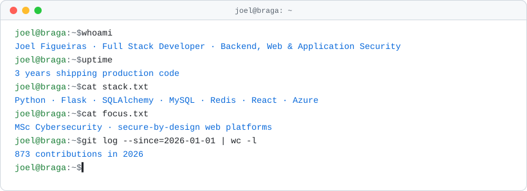
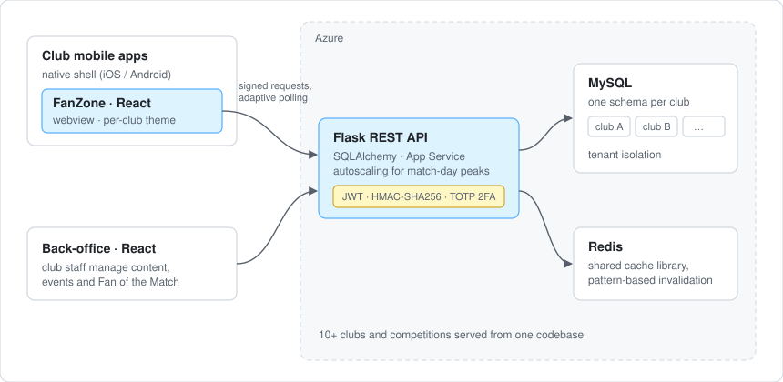

<picture>
  <source media="(prefers-color-scheme: dark)" srcset="assets/header-dark.svg">
  
</picture>

I build multi-tenant web platforms end to end — Python and Flask on the backend, React on the frontend, deployed on Azure — and I care about getting the security right from the first design sketch. For two years I was the only web developer behind a fan engagement product used by 10+ football clubs, and I'm now doing an MSc in Cybersecurity to go deeper on application security.

[LinkedIn](https://www.linkedin.com/in/joel-figueiras) · Braga, Portugal · open to relocation (UAE / EU)

## What I work on

- **PluggableAI (2024–2026)** — Full Stack Developer on *FanZone* and *Fan of the Match*, fan engagement platforms embedded in the official apps of football clubs in Portugal and Spain. Sole web developer: React web app, React back-office, Flask APIs, multi-schema MySQL, Redis and Azure.
- **Wave Solutions (2023–2024)** — built *Mobile Logistic* from scratch, a Kotlin Android app that takes the client's ERP to the warehouse floor, plus the C# microservices behind it.
- **4Dev (2024)** — full stack internship in a .NET and Angular team: background jobs with Hangfire and automated browser tests with Selenium.
- **MSc in Cybersecurity, Polytechnic Institute of Viana do Castelo (2025–)** · BSc in Computer Systems Engineering, Polytechnic Institute of Cávado and Ave (2023).

## Selected work

### FanZone — multi-tenant fan engagement platform

One codebase serving every club, each with its own branding and its own data.

- **Multi-tenancy** — one MySQL schema per club behind a single Flask/SQLAlchemy API, so tenants stay isolated while sharing the same code and deployments.
- **White-label frontend** — a design system of semantic CSS tokens and Tailwind v4 themes; a new club gets its look from a theme file, not a fork.
- **Live match data** — data layer moved to TanStack Query with a centralised query layer and adaptive polling, which fits the stateless, horizontally scaled App Service setup better than sockets.
- **Web inside native apps** — designed the web-to-native bridge for webview navigation: the native shell owns the app lifecycle, the web app owns its content navigation.
- **Security** — JWT auth, HMAC-SHA256 request signing, bcrypt password hashing, TOTP two-factor authentication and signed webview sessions.
- **Caching** — fixed cache invalidation in the shared Redis library by adding pattern-based deletes.

*The code is proprietary, so it isn't public — happy to walk through the architecture in a call.*

### Mobile Logistic — warehouse app on top of an ERP

- Kotlin / Jetpack Compose Android app for handheld terminals: guided picking, goods receipt, stock counts and transfers.
- Barcode-driven workflows (EAN-128, QR) with lot, expiry-date and serial-number capture.
- C# microservices exposing ERP documents, inventory and stock movements to the devices; piloted with client companies.

## Tools I use most

**Backend** — Python, Flask, SQLAlchemy, REST APIs, MySQL, Redis, C#, ASP.NET
**Frontend** — React, JavaScript, TanStack Query, Tailwind CSS, Vite, Angular
**Mobile** — Kotlin, Jetpack Compose
**Security** — JWT, HMAC request signing, bcrypt, TOTP/2FA, OAuth, OWASP Top 10
**Infrastructure** — Azure (App Service, Blob Storage, Cache for Redis), Docker, CI/CD, Firebase, Git, pytest

---

The header is drawn by a small, tested Python script ([`build.py`](build.py)) and redrawn every month by GitHub Actions, so the numbers stay current.

